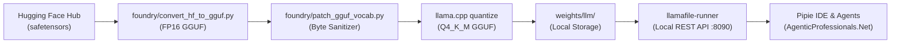

# Potential Future SLMs (Small Language Models) for Hayagriva & APNET

This document serves as an architectural evaluation and candidate registry of domain-specific **Small Language Models (SLMs)** (≤ 8 Billion parameters) for future incorporation into the **Hayagriva Operating System (`ide_models`)** and **AgenticProfessionals.Net**.

---

## 1. Selection Criteria & Architectural Gates

All candidate SLMs must meet the following baseline requirements to be incorporated into our stack:

| Criterion | Requirement | Rationale |
| :--- | :--- | :--- |
| **Parameter Size** | **0.5B – 8B Parameters** | Must run locally with sub-second token generation on unified memory (e.g., Apple Silicon M1–M4, standard 8GB–16GB RAM laptop CPUs) without enterprise GPU clusters. |
| **Quantization Profile** | **GGUF `Q4_K_M` (or `Q5_K_M`)** | Must compress to **≤ 4.5 GB** memory footprint with minimal perplexity degradation. |
| **Foundry Compatibility** | **LLaMA, Mistral, Qwen, or Phi base** | Fully convertible via our local [`foundry/convert_hf_to_gguf.py`](file:///Users/atulgrover/Desktop/ide_models/foundry/convert_hf_to_gguf.py) and executable via [`llamafile-runner`](file:///Users/atulgrover/Desktop/ide_models/weights/llm/llamafile/llamafile-runner). |
| **Confidentiality Gate** | **100% Offline / Air-Gapped** | Zero cloud telemetry to uphold attorney-client privilege, HIPAA, banking secrecy, and client NDAs. |
| **License** | **Open Weights / Permissive** | Apache 2.0, MIT, Llama 3 Community, or permissible research/commercial weights. |

---

## 2. Candidate SLM Registry by Professional Domain

### 🩺 A. Healthcare, Medicine & Clinical Operations
*Ideal for clinical consultation triage, electronic health record (EHR) charting, and medical case summary generation.*

| Model Candidate | Size | Base Model | Context | Key Capabilities | RAG Pairing |
| :--- | :--- | :--- | :--- | :--- | :--- |
| **OpenBioLLM-8B** *(Saama AI)* | 8.0B | Llama 3 | 8k | State-of-the-art open biomedical model; beats GPT-4 on USMLE medical licensing benchmarks; trained on PubMed and clinical guidelines. | `PubMedBERT` (768d) + `ms-marco` |
| **BioMistral-7B** | 7.2B | Mistral-7B | 8k | Pre-trained on PubMed Central open-access articles; excels at biomedical Q&A, clinical terminology, and diagnostic assistance. | `BioLinkBERT` (768d) |
| **Med42-v2 (8B)** *(M42 Health)* | 8.0B | Llama 3 | 8k | Tuned specifically for doctor-patient dialogue summarization, clinical reasoning, and treatment options review. | `PubMedBERT` (768d) |
| **ClinicalCamel-7B** | 7.0B | Llama 2 | 4k | Fine-tuned on real clinical dialogue datasets and EHR case notes for physician documentation assistance. | `BioLinkBERT` (768d) |

---

### 🛡️ B. Cybersecurity, SOC & Infrastructure Defense
*Ideal for air-gapped corporate networks, proprietary source audits, vulnerability triage, and SIEM alert enrichment.*

| Model Candidate | Size | Base Model | Context | Key Capabilities | RAG Pairing |
| :--- | :--- | :--- | :--- | :--- | :--- |
| **WhiteRabbitNeo-7B / 2.5** | 7.0B | Llama 3 / Mistral | 8k | Offensive & defensive cybersecurity; specializes in exploit analysis, incident response, reverse engineering, and threat mitigation. | `SecBERT` (768d) + `ms-marco` |
| **Llama-3-8B-SecOps** | 8.0B | Llama 3 | 8k | Fine-tuned on CVE databases, SIEM syslog parsing, incident playbooks, and automated YARA/Sigma rule generation. | `BGE-large` (1024d) |
| **PhishLlama-3B** | 3.0B | Phi / Llama | 4k | Lightweight edge model optimized for zero-latency email phishing detection, header spoofing analysis, and social engineering classification. | `InLegal-SBERT` or `BGE-M3` |

---

### 💻 C. Software Engineering, DevOps & Cloud Architecture
*Ideal for local in-IDE code completion, test generation, Git diff analysis, and CI/CD script automation without code privacy leakage.*

| Model Candidate | Size | Base Model | Context | Key Capabilities | RAG Pairing |
| :--- | :--- | :--- | :--- | :--- | :--- |
| **Qwen2.5-Coder-7B-Instruct** | 7.6B | Qwen 2.5 | 32k–128k | Current industry benchmark for SLM coding; supports 92+ programming languages, repo-level reasoning, and unit test synthesis. | `CodeBERT` (768d) + `ms-marco` |
| **Qwen2.5-Coder-1.5B / 3B** | 1.5B / 3B | Qwen 2.5 | 32k | Ultra-lightweight inline code completion models (~1GB VRAM); ideal for real-time tab autocomplete inside code editors. | `UnixCoder` (768d) |
| **Granite-Code-3B / 8B** *(IBM)* | 3.5B / 8B | Granite (Apache 2.0) | 4k–8k | Enterprise-cleansed code model; optimized for enterprise enterprise languages (Java, Python, C++, COBOL, SQL) and cloud DevOps scripts. | `CodeBERT` (768d) |
| **DeepSeek-Coder-6.7B-Instruct** | 6.7B | DeepSeek | 16k | High-accuracy code refactoring, project structure analysis, and automated pull request review generation. | `CodeBERT` (768d) |

---

### 📊 D. Quantitative Finance, Actuarial & Mathematics
*Ideal for financial derivatives modeling, actuarial risk curves, algorithmic trading strategies, and deterministic symbolic arithmetic.*

| Model Candidate | Size | Base Model | Context | Key Capabilities | RAG Pairing |
| :--- | :--- | :--- | :--- | :--- | :--- |
| **Qwen2.5-Math-7B-Instruct** | 7.6B | Qwen 2.5 | 4k | Top-tier open math model; outperforms many 70B models on GSM8K and MATH benchmarks via native chain-of-thought (CoT). | `Finance-Embeddings` (768d) |
| **NuminaMath-7B** *(AI-MO)* | 7.0B | DeepSeek-Math | 4k | Won 1st AI-MO Progress Prize; trained on competitive STEM and Olympiad math with integrated Python code execution reasoning. | `Finance-Embeddings` (768d) |
| **Llemma-7B** *(EleutherAI)* | 7.0B | CodeLlama | 4k | Specialized in formal mathematics, LaTeX theorem translation, and proof verification languages (Lean, Isabelle). | `Specter-2` (768d) |

---

### 🌾 E. Agriculture, Agronomy & Rural Vernacular Advisory
*Ideal for decentralized agri-tech deployments, offline farm advisory tablets, crop disease diagnosis, and vernacular language assistance.*

| Model Candidate | Size | Base Model | Context | Key Capabilities | RAG Pairing |
| :--- | :--- | :--- | :--- | :--- | :--- |
| **AgriParam / Dhenu-1 (2.9B)** *(BharatGen / KissanAI)* | 2.9B | Param-1 / Llama | 2k | Specialized in crop diseases, pest diagnosis, soil nutrient management, weather advisory, and government subsidy policies in regional languages. | `InLegal-SBERT` (Indian vernacular) |
| **Sarvam-2B** *(Sarvam AI)* | 2.0B | Sarvam Base | 4k | Efficient foundational model trained specifically on 10 Indian languages; excels in regional translation and administrative queries. | `BGE-M3` (Multilingual) |
| **AgriLLM (7B)** | 7.0B | Llama / Mistral | 4k | Soil chemistry, agricultural inputs, pesticide dosages, and supply chain logistics. | `AgriBERT` (768d) |

---

### ⚖️ F. Expanded Legal & Regulatory SLMs (Beyond IBC)
*Expanding from insolvency to corporate litigation, cross-border arbitration, IP patent claims, and tax compliance.*

| Model Candidate | Size | Base Model | Context | Key Capabilities | RAG Pairing |
| :--- | :--- | :--- | :--- | :--- | :--- |
| **Lawma-8B** | 8.0B | Llama 3 | 8k | Fine-tuned across corporate contract drafting, redlining, non-disclosure agreements (NDAs), and statutory compliance matrices. | `InLegal-SBERT` (768d) |
| **Legal-Llama-3-8B** | 8.0B | Llama 3 | 8k | General common law reasoning, case law citation retrieval, and appellate brief summarization. | `InLegal-SBERT` + `BGE-Reranker` |

---

## 3. Integration Roadmap & Implementation Steps

To incorporate any of the above candidate SLMs into our existing foundry and web application:



### Execution Commands (Template for New Model):
```bash
# 1. Convert downloaded Hugging Face model to FP16 GGUF
python3 foundry/convert_hf_to_gguf.py /path/to/downloaded_hf_model \
  --outfile weights/llm/new_domain/model-f16.gguf \
  --outtype f16

# 2. Patch BPE vocabulary (if non-standard tokenization)
python3 foundry/patch_gguf_vocab.py \
  weights/llm/new_domain/model-f16.gguf \
  weights/llm/new_domain/model-patched.gguf

# 3. Quantize to Q4_K_M for deployment
llama-quantize \
  weights/llm/new_domain/model-patched.gguf \
  weights/llm/new_domain/model-Q4_K_M.gguf \
  Q4_K_M

# 4. Register in manifest.json
# Add entry under "models.llm" in manifest.json with domain, contextWindow, and path.
```

---

## 4. Priority Recommendation for Next Additions

1. **Tier 1 (Immediate Synergy)**: **`Qwen2.5-Coder-7B-Instruct`** & **`Qwen2.5-Coder-1.5B`**
   - *Reason*: Directly elevates the **Pipie IDE** (`pipie_ide.html`) by giving practitioners local, zero-leakage code and query generation for automated statutory scrapers and ledger scripts.
2. **Tier 2 (High Enterprise Value)**: **`OpenBioLLM-8B`**
   - *Reason*: Opens up the medical & healthcare advisory vertical, where patient data privacy laws strictly forbid cloud LLMs.
3. **Tier 3 (Institutional Security)**: **`WhiteRabbitNeo-7B`** or **`Llama-3-8B-SecOps`**
   - *Reason*: Empowers air-gapped forensic audits and corporate digital forensics without exposing internal logs to external providers.
